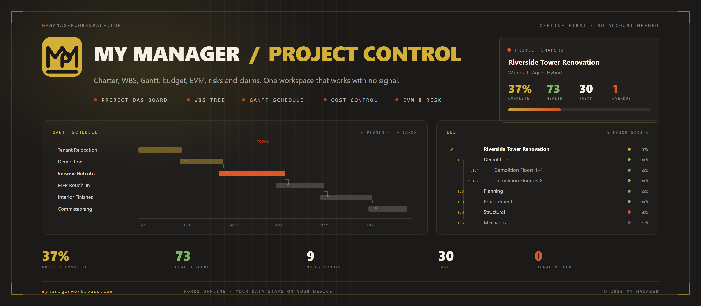
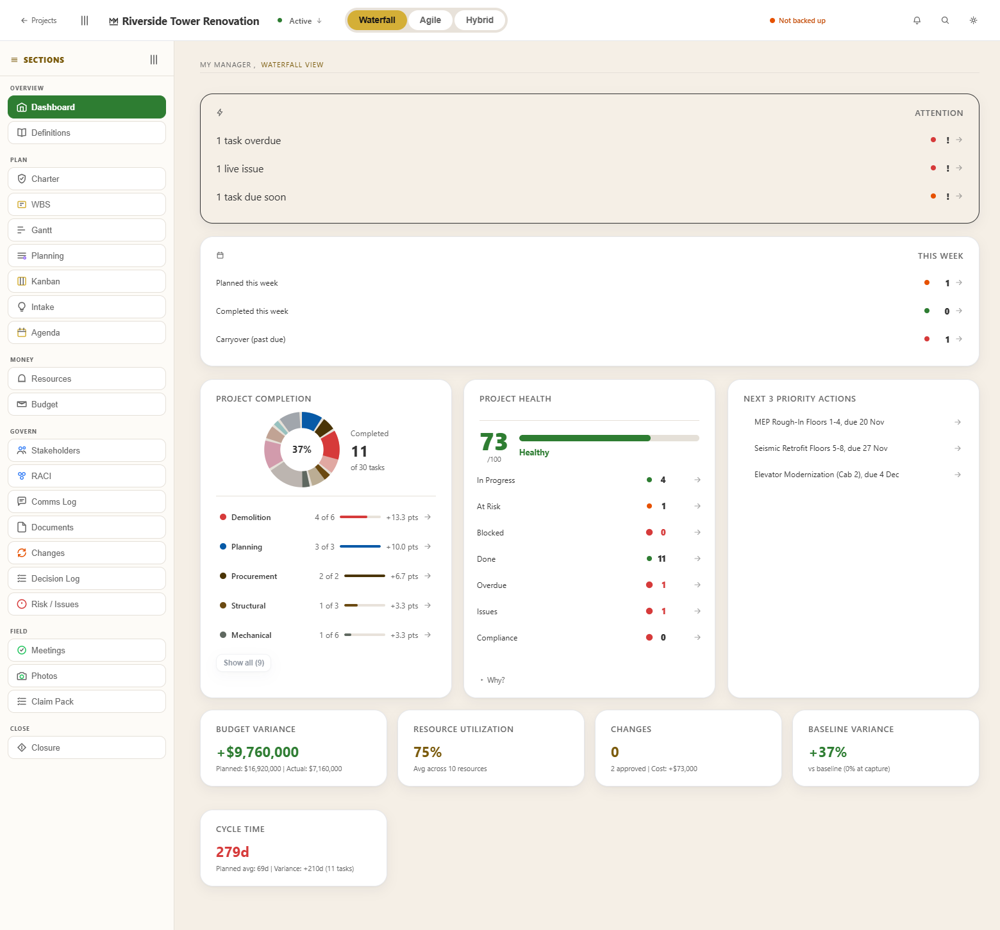
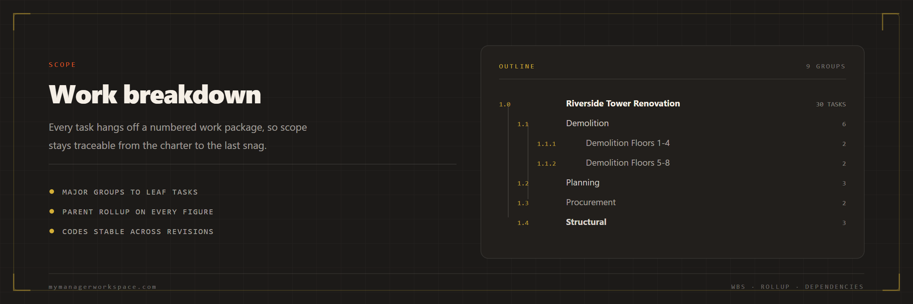
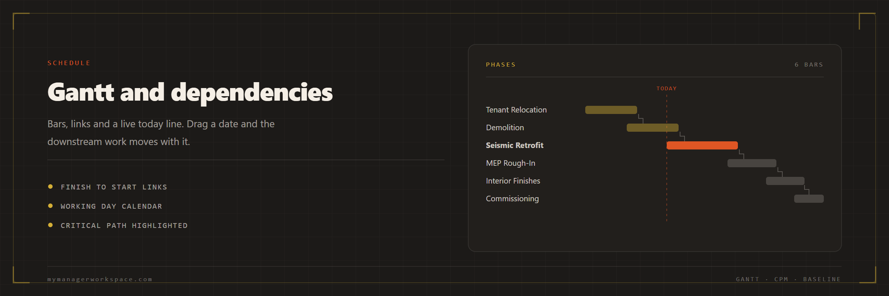
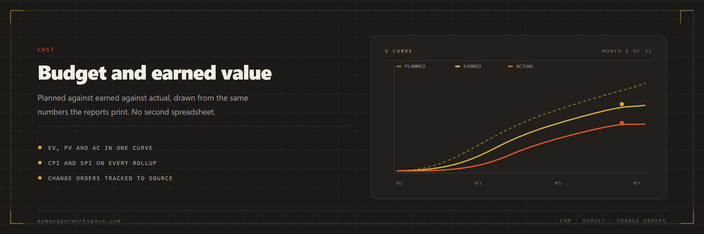
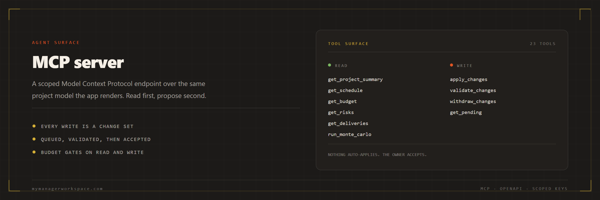
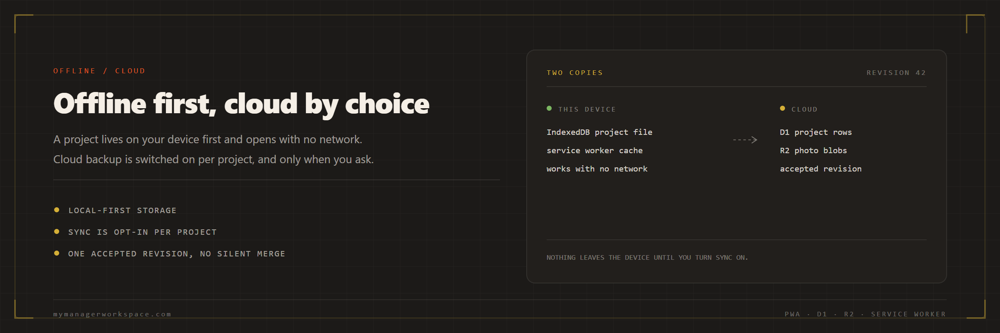
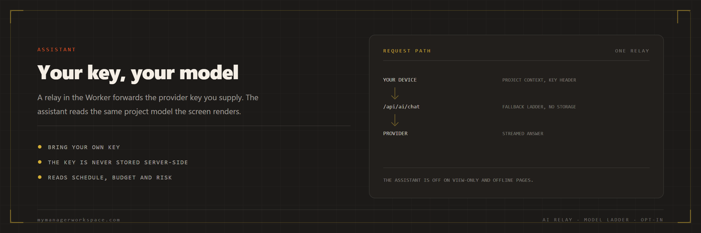

# My MaNaGeR

<p align="center">
  
</p>

An offline-first construction project-management workspace that runs in the
browser. No account and no payment are required to use it; an optional account
adds cloud backup, more linked projects, project photos and the full AI
assistant. Nothing stored on your device depends on either of those.

- **Live app:** https://mymanagerworkspace.com
- **Terms of Service:** https://mymanagerworkspace.com/terms.html
- **Privacy Policy:** https://mymanagerworkspace.com/privacy.html
- **Refund Policy:** https://mymanagerworkspace.com/refund.html

## What it does



*The demo project, captured from the running app - not a mockup. Every figure
below the fold comes from the same data the reports print.*

### Work breakdown



Tasks hang off numbered work packages so scope stays traceable from the charter
to the last snag. A parent row is a span over its children, so a rolled-up
duration is never the sum of the work beneath it.

### Schedule



Bars, finish-to-start links and a live today line over a working-day calendar.
Move a date and the downstream work moves with it; the critical path is
highlighted on the same row set.

### Cost and earned value



Planned, earned and actual on one curve, with CPI and SPI on every rollup.
The estimate, the bill of quantities and the budget read the same numbers - there
is no second spreadsheet to reconcile.

### Agent surface



A scoped Model Context Protocol endpoint over the same project model the app
renders. Reads are direct; every write is a change set that is queued,
validated and then accepted by the owner. Nothing auto-applies.

### Offline and cloud



A project lives on the device first and opens with no network. Cloud backup is
switched on per project and only when you ask; sync carries one accepted
revision, never a silent merge.

### AI assistant



A relay in the Worker forwards the provider key you supply. The assistant reads
the schedule, budget and risk model the screen shows, and is off on view-only
and offline pages.

The section art is generated from the repo:
`node tools/gen-readme-art.cjs` rewrites the six cards (and `--dashboard`
recaptures the demo dashboard).

## Stack

- Static front end (HTML/CSS/JS) served from Cloudflare Workers static assets.
- `worker.js` - security headers (CSP with per-script SHA-256 hashes),
  sign-in sessions via Google, Microsoft or email and password (HttpOnly HMAC
  cookie), BYO-AI-key relay (`/api/ai/chat`), and the D1 + R2 cloud sync API
  (`/api/cloud/*`).
- D1 database (`DB` binding) and R2 bucket (`R2` binding).
- PWA: `sw.js` service worker + `manifest.webmanifest`, offline-first.

## Local development

```bash
npm install
node build.js          # build all bundles (app, launcher, admin, marketing, CSS)
node serve.cjs         # serve on http://127.0.0.1:8765
```

Use `MMGR_SERVE_PORT=8767 node serve.cjs` to run on a different port.

## Verification

```bash
npm run verify         # CSP hashes, service worker, CSS integrity, eslint, prettier, ...
```

`npm run verify` is the gate that must pass before deploy. The only known
local-only failure on Windows is the prettier check on `manifest.webmanifest`
(CRLF); CI checks out LF and passes.

## Deploy

Follow the staging recipe in `wrangler.jsonc` (never deploy from the repo
root; wrangler uploads everything and does not honor `.gitignore`):

```bash
node build.js
STAGE="$HOME/mmgr-deploy"
rm -rf "$STAGE" && mkdir -p "$STAGE"
tar --exclude='.git' --exclude='.wrangler' --exclude='node_modules' \
  --exclude='.agents' --exclude='_archive' --exclude='tmp' -cf - . | tar -xf - -C "$STAGE"
cd "$STAGE" && npx wrangler deploy
```

## Community

- **Contributing:** `CONTRIBUTING.md` (read `AGENTS.md` first)
- **Code of Conduct:** `CODE_OF_CONDUCT.md`
- **Security policy:** `SECURITY.md` (report vulnerabilities privately)
- **Bug reports, feature requests and questions:** use the issue templates in
  `.github/ISSUE_TEMPLATE/`

The source is published for transparency and review. It is not licensed for
reuse, and the project is maintained by its owner.

## License

Proprietary. See `LICENSE`. The source is published for transparency and review
only; no license to use, copy, modify or distribute is granted.
